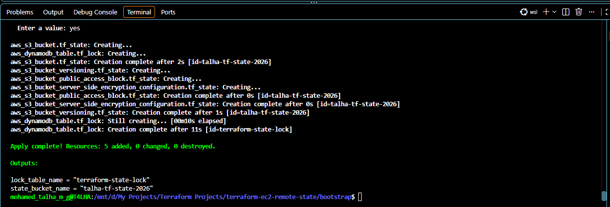
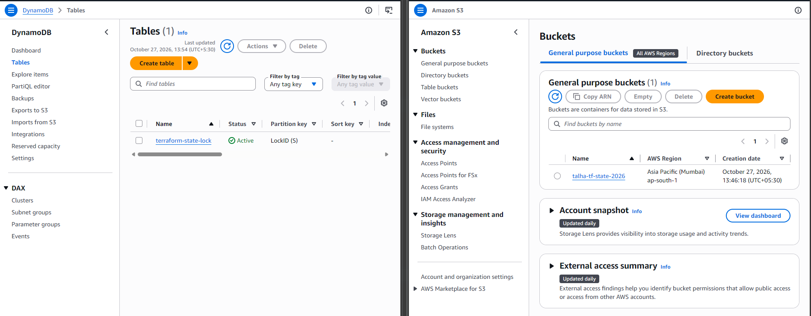
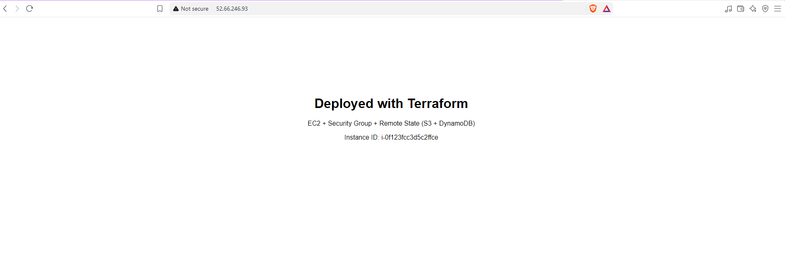
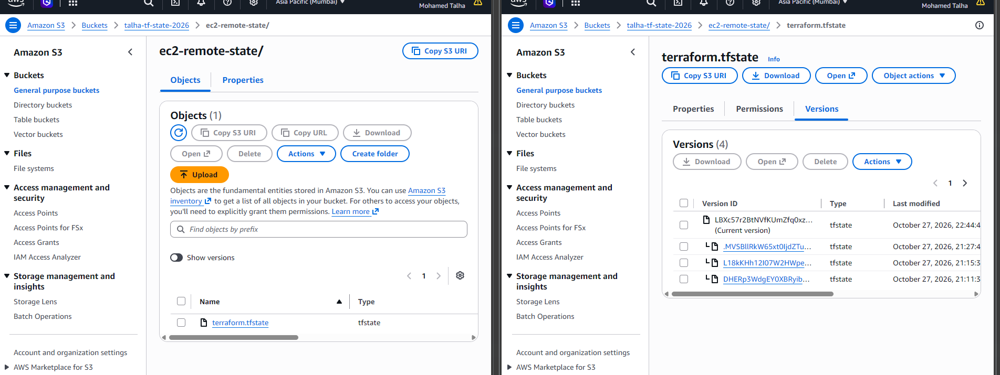

# Terraform on AWS — EC2 + Security Group with Remote State (S3 + DynamoDB)
 


 
Provisions an Ubuntu 24.04 web server on AWS EC2, protected by a least-privilege Security Group, with Terraform state stored **remotely in Amazon S3** and **locked with Amazon DynamoDB**. This is the standard setup for teams who share infrastructure code.
 
---
 
## Table of Contents
 
- [Why Remote State?](#why-remote-state)
- [Architecture](#architecture)
- [Tech Stack](#tech-stack)
- [Project Structure](#project-structure)
- [Security Practices](#security-practices)
- [Prerequisites](#prerequisites)
- [Getting Started](#getting-started)
- [Configuration](#configuration)
- [Outputs](#outputs)
- [Verification](#verification)
- [Troubleshooting: Issues I Hit and Fixed](#troubleshooting-issues-i-hit-and-fixed)
- [Cleanup](#cleanup)
- [What I Learned](#what-i-learned)
- [Author](#author)
---
 
## Why Remote State?
 
By default Terraform keeps `terraform.tfstate` on one laptop. That breaks as soon as a second engineer or a CI pipeline works on the same infrastructure.
 
| Problem with local state | How this project solves it |
|---|---|
| State lives on one machine; teammates can't see it | State is stored centrally in **S3** |
| Two `apply` runs at once can corrupt state | **DynamoDB** lock blocks concurrent runs |
| A deleted or corrupted state file loses track of infrastructure | **S3 versioning** keeps every previous state |
| State can contain sensitive values | **Encryption at rest** and **all public access blocked** |
 
---
 
## Architecture
 
```
                      ┌────────────────────────── AWS (ap-south-1) ──────────────────────────┐
                      │                                                                      │
 ┌──────────────┐     │   ┌────────────────────┐        ┌──────────────────────────────┐     │
 │  Developer   │ ────┼─► │  S3 Bucket         │        │  Default VPC                 │     │
 │  (WSL +      │     │   │  terraform.tfstate │        │  ┌────────────────────────┐  │     │
 │  Terraform)  │     │   │  versioned + SSE   │        │  │ Security Group         │  │     │
 └──────┬───────┘     │   └────────────────────┘        │  │  22  ← my IP (/32)     │  │     │
        │             │   ┌────────────────────┐        │  │  80  ← 0.0.0.0/0       │  │     │
        └─────────────┼─► │  DynamoDB Table    │        │  │  ┌──────────────────┐  │  │     │
          plan/apply  │   │  LockID (lock)     │        │  │  │ EC2 Ubuntu 24.04 │  │  │     │
                      │   └────────────────────┘        │  │  │ + Nginx          │  │  │     │
                      │                                 │  │  └──────────────────┘  │  │     │
                      │                                 │  └────────────────────────┘  │     │
                      │                                 └──────────────────────────────┘     │
                      └──────────────────────────────────────────────────────────────────────┘
```
 
The project is deployed in two stages:
 
1. **`bootstrap/`** creates the S3 bucket and DynamoDB table. It uses *local* state, because a backend cannot store its own state before it exists.
2. **Project root** creates the Security Group and EC2 instance, storing its state *remotely* in that bucket.
---
 
## Tech Stack
 
- **Terraform** ≥ 1.10, **AWS provider** ~> 6.0
- **AWS:** EC2, Security Groups, S3, DynamoDB
- **OS:** Ubuntu 24.04 LTS (AMI looked up dynamically from Canonical's official account)
- **Web server:** Nginx, installed at boot via `user_data`
- **Environment:** Ubuntu on WSL, AWS CLI v2
---
 
## Project Structure
 
```
terraform-ec2-remote-state/
├── bootstrap/               # One-time backend setup (local state)
│   ├── main.tf              #   S3 bucket (versioning, encryption, public access block) + DynamoDB lock table
│   ├── variables.tf
│   └── outputs.tf
├── scripts/
│   └── user_data.sh         # Installs Nginx and a landing page on first boot
├── screenshots/             # Proof of deployment used in this README
├── backend.tf               # S3 backend (partial config; values supplied at init)
├── versions.tf              # Terraform/provider versions + AWS provider with default tags
├── variables.tf             # Input variables with validation
├── main.tf                  # Ubuntu AMI lookup, Security Group + rules, EC2 instance
├── outputs.tf               # Instance ID, public IP, URL, SSH command
├── .env.example             # Template for environment variables (copy to .env)
├── .gitignore               # Keeps state, secrets and keys out of Git
├── .terraform.lock.hcl      # Pinned provider versions (committed on purpose)
├── LICENSE
└── README.md
```
 
---
 
## Security Practices
 
- **No secrets in code.** AWS credentials come from `AWS_PROFILE`; all account-specific values are `TF_VAR_*` environment variables loaded from a git-ignored `.env` file.
- **Backend values kept out of Git** with *partial backend configuration*: the bucket and table names are passed with `-backend-config` at `terraform init`.
- **SSH restricted** to a single IP (`/32`), with input validation on the CIDR.
- **Trusted AMI only.** The Ubuntu image is filtered by Canonical's owner ID, so look-alike community images can't be picked.
- **Hardened state bucket:** versioning, AES-256 encryption, all public access blocked, `prevent_destroy` lifecycle rule.
- **Hardened EC2:** encrypted gp3 root volume and **IMDSv2 enforced** (`http_tokens = "required"`).
- **`.gitignore`** excludes `*.tfstate`, `.terraform/`, `.env`, `*.tfvars`, plan files and `*.pem` keys.
---
 
## Prerequisites
 
- AWS account and an IAM user with permissions for EC2, S3 and DynamoDB
- [Terraform](https://developer.hashicorp.com/terraform/install) ≥ 1.10
- [AWS CLI v2](https://docs.aws.amazon.com/cli/latest/userguide/getting-started-install.html), configured with `aws configure`
- An **EC2 key pair** in the target region (default `ap-south-1`)
---
 
## Getting Started
 
**1. Clone and configure**
 
```bash
git clone https://github.com/mohamed-talha-m-g/terraform-aws-ec2-remote-state.git
cd terraform-aws-ec2-remote-state
 
cp .env.example .env
# Edit .env: unique bucket name, key pair name, your public IP
curl -s https://checkip.amazonaws.com   # your public IP, use it as <ip>/32
source .env
```
 
**2. Create the remote backend (one time)**
 
```bash
cd bootstrap
terraform init
terraform apply
cd ..
```
 
**3. Initialise the main project with the S3 backend**
 
```bash
terraform init \
  -backend-config="bucket=$TF_STATE_BUCKET" \
  -backend-config="dynamodb_table=$TF_LOCK_TABLE" \
  -backend-config="region=$AWS_REGION"
```
 
**4. Plan and deploy**
 
```bash
terraform fmt -recursive
terraform validate
terraform plan -out=tfplan
terraform apply tfplan
```
 
> **Note:** Recent Terraform versions warn that `dynamodb_table` is deprecated in favour of S3 native locking (`use_lockfile = true`). DynamoDB locking still works and is used here deliberately, since it is the setup most existing teams run.
 
---
 
## Configuration
 
All inputs are environment variables: `TF_VAR_<name>` sets `var.<name>`.
 
| Variable | Description | Default |
|---|---|---|
| `TF_VAR_aws_region` | AWS region | `ap-south-1` |
| `TF_VAR_instance_type` | EC2 instance type | `t3.micro` |
| `TF_VAR_key_name` | EC2 key pair **name** (without `.pem`) | required |
| `TF_VAR_ssh_allowed_cidr` | CIDR allowed to SSH (your IP `/32`) | required |
| `TF_VAR_environment` | Environment tag | `dev` |
| `TF_VAR_state_bucket_name` | State bucket name (bootstrap) | required |
| `TF_VAR_lock_table_name` | Lock table name (bootstrap) | `terraform-state-lock` |
 
`TF_STATE_BUCKET` and `TF_LOCK_TABLE` (no `TF_VAR_` prefix) are used only in the `terraform init` command.
 
---
 
## Outputs
 
| Output | Description |
|---|---|
| `instance_id` | EC2 instance ID |
| `ami_id` | Ubuntu AMI used |
| `public_ip` | Public IP of the instance |
| `security_group_id` | Attached Security Group |
| `website_url` | `http://<public-ip>`, verifies port 80 |
| `ssh_command` | Ready-to-use SSH command, verifies port 22 |
 
---
 
## Verification
 
**Backend created by `bootstrap/`:** 5 resources (S3 bucket, versioning, encryption, public access block, DynamoDB table)
 

 
**S3 bucket and DynamoDB lock table (partition key `LockID`) in ap-south-1**
 

 
**EC2 is running with the correct Security Group**
 
```bash
aws ec2 describe-instances --instance-ids $(terraform output -raw instance_id) \
  --query "Reservations[].Instances[].{State:State.Name,SG:SecurityGroups[0].GroupName,IP:PublicIpAddress}" \
  --output table
```
 
**HTTP (80) and SSH (22) work**
 
```bash
curl $(terraform output -raw website_url)
$(terraform output -raw ssh_command)
```
 

 
**State is stored in S3, not locally.** Bucket versioning keeps every previous state file, so a bad change can be rolled back.
 
```bash
aws s3 ls s3://$TF_STATE_BUCKET/ec2-remote-state/
terraform state list
```
 

 
**Locking works in DynamoDB.** With `terraform apply` waiting at its prompt in one terminal, `terraform plan` in a second terminal fails with `Error acquiring the state lock` until the first run finishes.
 
---
 
## Troubleshooting: Issues I Hit and Fixed
 
Real problems from building this project, and how I diagnosed them.
 
| Symptom | Root cause | Fix |
|---|---|---|
| `terraform init`: S3 bucket `yourname-terraform-state-2026` does not exist | `.env` still had the placeholder bucket name | Set the real name in `.env`, `source .env`, re-run `terraform init -reconfigure` |
| `InvalidKeyPair.NotFound: The key pair 'default-key.pem' does not exist` | `key_name` needs the key pair **name** in AWS, not the `.pem` file name | `TF_VAR_key_name="default-key"`; checked with `aws ec2 describe-key-pairs` |
| Browser: `ERR_CONNECTION_TIMED_OUT` | Brave upgraded the request to HTTPS (port 443), which the Security Group doesn't allow | Tested with `curl -v http://...`, which showed the real error |
| `curl`: `Connection refused` on port 80 | Nginx never started: `user_data` failed at boot | See next row |
| `cloud-final.service` failed; log showed `E: Invalid operation updte` | Typo in `user_data.sh`; `set -e` stopped the script before Nginx installed | Read the boot log with `aws ec2 get-console-output`, fixed the typo; `user_data_replace_on_change` rebuilt the instance |
 
---
 
## Cleanup
 
```bash
# Remove the EC2 instance and Security Group (state stays in S3)
terraform destroy
```
 
To remove the backend as well: delete the `prevent_destroy` rule in `bootstrap/main.tf`, empty all object versions in the bucket from the S3 console, then run `cd bootstrap && terraform destroy`.
 
> ⚠️ Destroy the backend **last**. The main project's state lives in it.
 
---
 
## What I Learned
 
- Solving the remote-state *chicken-and-egg* problem with a separate bootstrap configuration.
- How the S3 backend stores state and how DynamoDB's `LockID` item prevents concurrent changes.
- Why backends can't use variables, and how partial backend configuration with `-backend-config` works around it.
- Keeping secrets out of Git with `TF_VAR_*` environment variables, `.env` files and a well-designed `.gitignore`.
- Looking up AMIs with a data source filtered by the publisher's owner ID instead of hard-coding IDs.
- Debugging EC2 boot scripts from the CLI with `aws ec2 get-console-output` and `cloud-init` logs.
---
 
## Author
 
**Mohamed Talha M G**
DevOps Engineer | AWS · Terraform · Docker · Kubernetes
 
- GitHub: [@your-username](https://github.com/mohamed-talha-m-g)
- LinkedIn: [your-profile](https://www.linkedin.com/in/mohammed-talha-m-g)
---
 
## License
 
This project is licensed under the [MIT License](LICENSE).